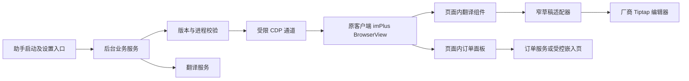

# 旅游商家助手 Chromium 内嵌重构计划

日期：2026-10-15。阶段：读取现有程序后的设计计划，尚未实施重构。

## 1 结论与交付目标

把助手的翻译预览、草稿替换和订单查询界面放进旅游商家桌面版现有客服 BrowserView 的网页中。复用原客户端的窗口、Chromium 渲染器与客服页面生命周期；后台只承担连接、认证、业务请求和状态管理。

首选路线是复用本项目已有 CDP 运行时附加能力，在经过版本核验的 imPlus 页面内挂载组件。无需重写 Chromium，也不需要重新做一个承载厂商网站的 Electron 壳。当前独立浮层退出日常工作流，原客户端继续负责账号、聊天、附件和最终发送。

本阶段只产出计划与静态取证副本。没有修改厂商安装文件、用户热更新文件或业务数据，没有启动、重启、注入客户端或发送客户消息。旧文档中的操作步骤是参考资料，不作为本次执行授权。

完成标准：用户从原客户端客服页使用助手；翻译预览和订单结果均显示在该页内；确认译文只替换草稿，发送仍由用户在原客户端完成；页面切换、断连或升级时助手能停止并清理。

## 2 本次读取到的厂商程序

### 2.1 当前资源基线

| 项目 | 本次读取结果 |
|---|---|
| 安装目录 | `C:/Program Files/vbk-electron/` |
| EXE 文件版本 | `1.2.11.2664320` |
| ASAR package 版本 | `1.2.11` |
| 主入口 | `dist-electron/main/index.js` |
| 安装内页面版本 | `pkgVersion=1.2.11`，`aresVersion=1.2.14` |
| 用户目录留存页面 | `pkgVersion=1.2.6`，`aresVersion=1.2.10` |
| 客服入口 | `dist/src/pages/imPlus/index.html` |
| 安装内客服主 bundle | `js/imWindow-DfcqWwN2.js` |
| ASAR SHA256 | `31a70162330e448574480960930b2e5b05d78d07ccd1a66e1c8517525f46aef6` |
| 客服 bundle SHA256 | `4e3ba5aa01063a0ed9ebe11ef545040f797dbe33f71aff68cd45e98de3041f87` |

本次从 ASAR、安装网页及用户目录网页读取并保存了 57 个静态文件。原始路径、大小和 SHA256 见 [manifest.json](../work/chromium-refactor-20261015/manifest.json)，限定源码片段见 [evidence.json](../work/chromium-refactor-20261015/evidence.json)，复现脚本见 [inspect.cjs](../work/chromium-refactor-20261015/inspect.cjs)。这些副本仅用于本地分析，不进入发布包。

主进程 `isUserPath()` 比较安装与用户目录的 `aresVersion`，启动时据此选择 `UNPACKED_DIST`。按照当前静态文件，安装内 `1.2.14` 高于用户目录 `1.2.10`，应选择安装内页面。此结论是启动逻辑推导；实际运行的 target URL 和页面版本必须在连接阶段再核实，不能拿旧用户目录的 HTML 当作当前运行页。

本项目适配表记录 Chromium major 118，但本轮没有读取运行时 `Browser.getVersion`，不能把配置值当成新的运行时版本证据。

### 2.2 窗口与页面承载

主进程 `jumpToMainUrl()` 按业务账号及 pageType 缓存 BrowserView；`createBrowserView()` 使用 `session.fromPartition('persist:' + buid)` 创建账号分区。客服 imPlus 和 notice 页面选用 `preload/im.js`，随后通过 `loadFile()` 或 `loadURL()` 加载。

因此内嵌位置是 **imPlus BrowserView 的 document**，不是主窗口外面叠一个跟随窗口，也不是另开一个浏览器。多账号切换可能涉及不同 BrowserView，必须按 target、frame 和账号代次分别维护状态。

证据：本次主进程副本 L87，`async jumpToMainUrl` 字符偏移 251519；`createBrowserView` 片段见 evidence。偏移单位为 UTF-16 字符，压缩文件行号只用于辅助定位。

### 2.3 编辑器与现有桥接

客服 bundle 含 React 页面、Tiptap/ProseMirror 编辑器，`chat-editor`、`onUpdate` 和 `realTimeTranslate` 均可定位。厂商已有实时翻译逻辑，助手不能覆盖它的 handler 或假设自己独占编辑器更新事件。

`preload/im.js` 暴露 `appBridge`、`postImMessage`、`postMainMessage`、`setIMMessageHandler` 等接口。其中 `setIMMessageHandler` 是单槽赋值，助手调用它可能取代厂商自己的回调，不能作为扩展入口。

与旧调查不同，当前 preload 的 window message 入口已有 origin/source 等判定逻辑。旧文档“未见 origin/source 校验”的描述不能沿用到本版本。存在内部桥接也不等于存在公开插件 SDK；本次限定源码中未建立官方扩展加载合同。

证据：当前 preload L1；客服 bundle L227 的编辑器与实时翻译片段。原生订单区域存在 iframe 结构，不能假定外层 DOM 可以稳定读取其中的订单业务数据。

### 2.4 更新机制

`replaceNewVersion()` 将用户 `dist` 移到 `dist.back`，解压新包，再清理备份。升级可以替换页面内容和 bundle 名称。主入口还存在单实例锁，因此对已经运行且没有受控调试端口的客户端再传启动参数，不能假定会开启端口。

重构必须在每次附加时重新确认实际资源和进程身份。未知版本停用助手、保留原客户端正常工作；不能抬高版本号、冻结厂商升级或自动给未知 bundle 打补丁。

## 3 当前项目如何迁移

项目当前同时留有独立浮层、runtime 内嵌和静态补丁三套实现。默认 package 入口仍是独立 Electron main，版本为 0.2.3。应统一业务状态机与发布入口，而不是把三套实现继续并排维护。

| 现有模块 | 处理方式 | 原因 |
|---|---|---|
| `electron/companion-service.ts` | 提取为与 UI 无关的业务服务 | 保留当前认证、取消、草稿失效与替换前检查 |
| `electron/external-composer.ts` | 保留窄接口并迁移到 runtime host | 当前接口以 read/renew/replace/close 为边界 |
| `runtime/transport.ts`、`attachment.ts`、`identity.ts` | 复用并集中版本配置 | 已有附加代次、进程身份及回环监听校验 |
| `runtime/runtime-ui.tsx`、`runtime/page/*` | 作为主 UI 起点 | 已有隔离世界、Shadow DOM、租约及清理机制 |
| `runtime/native-composer.ts` | 保留读草稿与受限替换；移除发送分支 | 旧实现仍含发送按钮 click 路径 |
| `runtime/outbound-controller.ts`、`driver.ts` | 合并或退役旧业务入口 | 避免恢复 `replace-send`，避免两套默认语言及 debounce 行为 |
| `runtime/page/operator-overlay.ts` | 复用显示与消息协议，补内嵌登录验收 | 外部浏览器 profile 不能直接等同于 iframe 登录态 |
| `electron/main.ts` 的跟随浮窗与 `native/windows` 定位链 | 从日常内嵌路径移除 | 页面布局不应再依赖屏幕坐标与窗口跟随 |
| `embedded-shell`、`scripts/patch-client.mjs` | 标记历史实验，不进入默认 build | 旧方案固定 1.2.6/1.2.10，并涉及静态文件修改 |
| `runtime/build-runtime.mjs` | 接入常规 build/package | 移除 work 目录产物与机器绝对路径依赖 |

当前 `CompanionService` 与旧 runtime 的默认语言、自动语言策略和触发延迟不同。迁移先保持当前产品行为，使用唯一配置来源；“自动跟随客户语言”作为显式设置，不随架构迁移悄悄启用。

## 4 目标架构与实现边界

### 4.1 UI 和后台的边界

后台可以暂时复用本项目 Electron 主进程和托盘，但不再为翻译、订单创建日常工作浮窗。设置或认证入口可以单独存在；业务面板实际由厂商 Chromium 渲染。

在原 `#root` 之外创建自有宿主，Shadow DOM 隔离样式。初始布局采用回复区附近的紧凑翻译条，订单点击后打开页面内面板；空间不足时折叠。所有布局改动记录原值，卸载时只恢复自己仍持有的改动。

Shadow DOM 仅隔离样式，不是权限边界。运行时逻辑优先放在隔离 world；需要访问编辑器实例时只执行固定、经过审核的草稿读写适配函数，不接收任意 JavaScript，不操作 React 私有 fiber，不覆盖厂商 IM handler。

### 4.2 连接和生命周期

1. 只读识别 EXE、ASAR、实际页面、bundle 和版本，匹配适配清单。
2. 用户正常启动助手时，若原客户端已运行，优先验证是否属于此前受控启动的实例。无可验证通道时显示明确状态，不杀进程、不自行重启。
3. 需要启动时复用现有 launcher，仅连接经 PID、启动时间和回环监听核对的客户端。既有 `DevToolsActivePort` 文件本身不能证明端口归属。
4. 只附加批准的 imPlus target/frame；导航、账号或 frame 变化立即废弃旧代次。
5. UI 使用租约与心跳；主动关闭立即清理，后台崩溃时租约超时清理组件、observer、iframe 和布局。

现有 driver 遇到多个合法 imPlus target 会报 `AMBIGUOUS_IM_TARGET`。P0 必须补齐可信的活动 BrowserView 识别与逐 target 生命周期；无法可靠识别时拒绝附加，不能取枚举结果的第一个。多账号支持未完成前，只能交付明确标注的单账号试用版本，不能算最终验收通过。

CDP 是高权限通道，回环地址不能防御所有本机进程。应用内白名单不能把原始调试端口变成低权限端口。适用边界是可信本机环境；不开放远程监听、不暴露任意执行接口。关闭助手可断开并卸载，但原客户端的调试监听可能持续到该进程正常退出，不能承诺断连即关闭端口。

### 4.3 翻译和草稿替换

状态流统一为：未连接 → 就绪 → 翻译中 → 可替换，另有过期、认证失效与失败状态。每个请求绑定 target、frame、账号代次、会话、编辑器实例、草稿修订和目标语言。

翻译认证第一阶段沿用当前 `CompanionService` 的 `BrowserProfileSessionService` 路径，先核实其现有登录流程与凭据存储；不因恢复旧 runtime 而切换到 `OwnedAuthClient`。凭据只留后台，页面仅接收认证状态；登出或重登增加认证代次并废弃在途结果。这里复用的是助手自身的 TSim 登录，不读取厂商账号凭据。订单 iframe 的登录身份另行验证，不假定与翻译会话共享；若产品要求统一登录，须在 P0 建立明确认证合同后再调整。

确认替换时再次读取这些条件；任一变化或正在 IME 组合输入即拒绝。只对明确支持的纯文本草稿调用 Tiptap API，并验证写后状态和应用更新事件；含图片、复杂节点或无法确认编辑器身份时禁用替换。保留撤销体验并验收。

桥接协议只允许读取状态、翻译、取消、改目标语言、替换草稿及显式查询订单等操作。删除 `replace-send`、`SendingComposerPort` 和点击厂商发送按钮的可达调用链；不模拟 Enter 来实现写入。

### 4.4 订单查询与认证

第一版仅将明确的“订单 ID”入口和用户明确选择的标识变成查询动作，标识始终使用字符串。不能把任意消息数字都自动当订单号；平台订单号与 TSim 标识的映射必须由真实服务合同确认。

优先验证现有 `/embed/operator` 在原 BrowserView 内能否完成独立登录、查询和读回。所有 postMessage 验证精确 origin、source、请求 ID 和会话代次；旧请求不能覆盖新订单。

实施前先核实 frame-ancestors、Cookie、实际 session partition 及当前嵌入协议。厂商源码有较宽的网页安全配置，不能据此认为远端 iframe 已获得可靠隔离。若无法证明内嵌认证与权限边界可用，则改用后台受限查询 API 加本地结果组件；这需要真实 API 合同和认证方案，不能凭空实现。两条路线均未验证时，内嵌订单功能标为阻塞，不能以外部浏览器代替最终验收。

不复制浏览器 profile、读取厂商 token 或利用宽泛 IPC 代理查询。首版订单面板仅查询和展示，不引入发送、退款、取消等写操作。

## 5 分阶段实施顺序

| 阶段 | 主要工作和预计影响文件 | 阶段出口 |
|---|---|---|
| P0 运行基线 | `runtime/identity.ts`、`cdp-policy.ts`、`runtime-ui.tsx` 集中适配清单，核对真实 target 与服务合同 | 能证明实际承载页；订单认证路线确定；未知版本明确停用 |
| P1 页面容器 | `runtime/page/index.ts`、`outbound-panel.ts`、`attachment.ts` 接入空面板及清理 | 面板确实在原 DOM 内；重载、切账号、断连无残留 |
| P2 单一业务服务 | 提取 `companion-service`，增加小型有类型桥接；退役旧控制器发送动作 | 翻译状态和既有行为一致；生产入口无发送能力 |
| P3 草稿读写 | 收敛 `native-composer`，实现请求与替换双重条件校验 | IME、富文本拒绝、草稿过期、写后读回、撤销实测通过 |
| P4 内嵌订单 | `operator-overlay` 或受限查询结果组件 | 原页内完成登录及真实查询；订单切换不串结果 |
| P5 发布收敛 | `package.json`、构建脚本、main 入口、说明文档 | 干净构建仅包含当前路线；可安装、卸载、回退 |

建议按 P0 到 P5 顺序推进。P0 的登录与接口验证应尽早完成；不要先完成全部视觉工作才发现订单 iframe 无法使用。阶段出口未达成时保留禁用状态和明确原因，不假装完成。

## 6 验收与回退

自动化与真实客户端测试分别记录通过、失败、未测、阻塞，并记录 EXE/页面版本、适配器版本与测试日期。

| 验收类别 | 必须覆盖的情形 |
|---|---|
| 真内嵌 | DOM/Shadow DOM 证据；拖动、最大化、缩放、多 DPI、最小化；没有依赖屏幕坐标的业务浮窗 |
| 生命周期 | 页面重载、切账号、切会话、编辑器重建、后台崩溃、原进程退出；无重复监听或残留布局 |
| 翻译 | 成功、超时、取消、认证失效、语言切换、响应乱序；不污染新的草稿或会话 |
| 草稿替换 | 中文 IME、普通输入、富文本、替换后撤销；用户确认前不改草稿，任何助手动作不发送 |
| 订单 | 登录成功/失效、真实查询、无结果、网络失败、连续切单、重新打开；核实跨系统编号含义 |
| 兼容与更新 | 安装资源和用户更新资源选择、未知 bundle 拒绝、重新适配；厂商文件前后 hash 一致 |
| 性能 | 同一会话同一机器比较未附加与附加：空闲/输入/切会话的 CPU、内存、长任务和 UI 延迟；后台隐藏时停止不必要扫描 |
| 发布 | 从常规构建生成包，不依赖 work 目录；新启动、关闭、卸载、旧版恢复可复现 |

性能门槛在 P0 取得未附加基线后确定，再作为发布条件。优先采用编辑器事件与局部 DOM observer；200ms 全局轮询不能未经实测直接沿用。DOM observer 必须过滤自有节点，避免渲染自己触发新的扫描。

运行时回退：先取消请求与清空身份代次，再卸载组件、恢复布局和断开连接。卸载不触碰厂商资源和账号数据。保留旧助手包作为手工回退产物，但内嵌失败时不自动启动旧浮层掩盖故障。

## 7 当前证据能确认和仍需确认的事项

已确认：当前安装版本及静态页面版本、资源选择逻辑、BrowserView 承载结构、账号 session 分区、preload 桥接形态、编辑器相关代码，以及现有项目可复用的内嵌模块。

尚未确认：本轮运行中的 target URL/Chromium 版本、实际 DOM 唯一性、真实 IME 与草稿回填、内嵌认证和订单 API、连续运行性能。没有运行这些测试，因此本计划不宣称已实现或已通过客户端验收。

历史调查提示热更新与登录隔离风险；本计划中的版本和源码结论已用本轮静态文件重新核对。旧的 1.2.6/1.2.10 补丁方案不作为当前实施基线。
