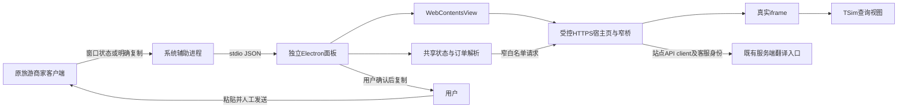

# 旅游商家客户端扩展开发方案

版本日期：2026年10月14日。适用对象：产品负责人、客户端开发人员、TSim及翻译服务维护人员。范围为开发方案和验收设计，不包含插件实现或上线。

## 方案结论

首版保留旅游商家桌面版，在其旁边增加独立的查询和翻译面板。面板提供订单号输入与候选确认、TSim查询、入站消息翻译、出站草稿翻译，以及用户确认后的复制操作。客户消息最终由用户在原客户端人工发送。

推荐使用 Electron、TypeScript、React和Vite实现独立面板；Windows通过C#系统辅助进程跟随原窗口，Mac通过Swift与AppKit辅助进程实现同一职责。共享代码负责订单解析、会话状态、翻译请求和查询协议；系统辅助进程只负责窗口和经授权的辅助功能。首版使用手动输入、显式复制、用户在原编辑器人工粘贴的闭环，自动读取会话、识别订单和安全回填作为通过专项验证后启用的增强能力。

`C:\Develop\respondio_message_translate`作为用户功能和操作流程参考，不整体复制其Chrome扩展实现。手动复制粘贴是首个可交付阶段，最终目标仍是原消息自动读取与翻译、订单联动查询、原编辑器随动预览及安全回填；各项自动能力按实测门槛启用，不能把最终目标降为剪贴板工具。

当前Windows安装包已证实为Electron应用，消息界面使用本地React renderer，主窗口通过多个BrowserView切换内容，部分订单内容采用远程iframe。内部preload、MessagePort和编辑器代码不构成公开外部SDK。普通Chrome扩展能否装载到原客户端、外部程序能否访问业务DOM，均不能由“它使用Chromium”直接推出。现有运行进程未显示调试端口；首版不依赖CDP。

Mac目前没有安装包或可运行样本。方案能够隔离平台差异，但Mac是否支持相同业务界面、窗口跟随、自动读取与回填，须在真实Mac客户端上单独验收。Windows结果不能代替Mac结果。

## 当前客户端事实与功能单元

本次现场看到主窗口标题为“旅游商家桌面版”，程序位于 `C:\Program Files\vbk-electron\旅游商家桌面版.exe`，应用标识为 `com.ctrip.vbooking`。业务数据、客户身份和对话内容不写入交付文档。

| 功能单元 | 当前可见或静态事实 | 对首版面板的意义 |
| --- | --- | --- |
| 左侧业务导航 | 消息、通知、事件、分销、商服、产品、订单、数据、点评、工作台 | 跟随主窗口，不把某个业务页视为全部客户端 |
| 会话列表与消息区 | 本地React renderer；界面有客户端内置翻译 | 入站翻译须区分客户原文与客户端译文 |
| 回复编辑器 | Tiptap及ProseMirror静态实现，含发送快捷键 | 首版复制译文；自动回填须验证编辑器状态及IME |
| 会话右侧订单区 | 可见订单ID、产品、日期等；静态代码含订单iframe | 订单号优先来自明确字段，不能抓取任意数字即查询 |
| 订单业务页 | 本地renderer选择菜单href，再加载远程iframe | 实际URL受环境、登录和菜单权限影响 |
| 内部通信 | preload与MessagePort连接内部IM进程 | 不能直接当作可供外部应用调用的协议 |
| 无障碍读取 | 本次UIA仅约11个窗格及窗口按钮节点 | 当前路径未读到消息、订单、编辑器；不代表所有版本永久不可读 |
| 调试入口 | 当前启动摘要无remote-debugging-port，应用进程无TCP监听 | CDP需另行评估和受控启用，不能默认连接成功 |

安装包版本为1.2.6，EXE版本信息为1.2.6.2397311，二进制包含Electron 27.3.11及Chromium 118线索。应用支持用户目录热更新，因此安装包renderer不一定等于正在运行的renderer。后续自动化适配必须记录实际客户端版本和能力探测结果，而不能只按安装包版本选择selector。[静态证据S1至S8见技术取证摘要]

## 功能对照与桌面化交互

参考项目核对版本为commit `fa4924f64e7680c6b1c0d2f4d70e4574841268ed`，manifest与package版本均为1.4.0。以下参考行为已由当前src静态核对，未在旅游客户端运行验收；README旧FAQ的1.0.10不作为当前版本依据。[功能证据F1至F7见技术取证摘要]

| 用户收益 | 参考项目行为 | 新桌面面板交互 | 阶段及前置能力 |
| --- | --- | --- | --- |
| 看懂外语并保留原文 | 原气泡附近显示译文，也处理识别到的已发外语气泡 | 阅读区并排或上下显示原译文，可翻译客户消息及已发消息；明确来源 | 阶段1手动导入；阶段3自动读取可见、新到及历史消息 |
| 回复时提前看译文 | 原composer停止输入1.5秒后预览，不自动发送 | 在面板内编写或粘贴草稿，停止输入后随动预览；建议默认1.5秒且可调整 | 阶段1可交付，不依赖读取原编辑器；阶段3再跟随原草稿 |
| 适配客户语种 | 跟随最近客户消息，未知时用默认语种；中文主导会话抑制随动 | 先手选目标语种及默认值；增强后展示跟随依据、抑制原因并允许覆盖 | 自动策略须可靠捕获客户原文并验证本地检测；不能用服务auto回显充当检测 |
| 译文进入回复流程 | 复制或主动替换原文；快捷键替换不会发送 | 首阶段复制、用户人工粘贴；增强后确认写回，可配置快捷操作 | 原身份、草稿版本、IME与快捷键冲突验收通过才写回 |
| 控制翻译节奏 | 取消会暂停当前会话路由，切换会话恢复；另有全局开关 | 分设取消本次、暂停当前面板上下文、关闭随动；手动模式明确恢复 | 阶段1不假称知道原会话切换；阶段3才按真实会话恢复 |
| 检查语义偏差 | 可选中文回译，默认关闭；使用Google免费通道 | 可选中文回译走tsim_cs统一服务，单独状态与失败提示，不抹掉主译文 | 后续可选模块；先确认purpose契约、配置、额度及质量复核 |
| 减少重复等待 | 历史消息靠近视口才翻译，重绘后从缓存恢复，合并在途请求 | 先缓存面板已导入内容；增强后按可见消息调度和恢复，不改变原客户端滚动 | 阶段1账号隔离缓存；阶段3需稳定消息及内容版本 |
| 快速查询标识 | 消息和只读联系人字段高亮ICCID、eICCID及订单候选并可点击 | 明确导入文本生成候选列表，选中后在贴边查询区打开；不要求改原消息样式 | 阶段1可选候选；阶段2确认查询与映射；阶段3自动提取 |
| 查询更快且状态可见 | 查询窗口预热、切对象更新、切会话关闭 | 显示待机、加载、失败与重试，认证通过后按需预热 | 阶段2真实iframe协议；会话自动联动依赖阶段3 |
| 使用eSIM安装信息 | 单个受支持链接展开二维码、ICCID、SM-DP+及激活码，可复制和查询 | 可选安装卡片；多个链接列候选并由用户确认归属 | 后续可选模块，仅在授权数据源和真实解析结果确认后启用 |
| 失败后可恢复 | 出站手动重试、入站有限退避，打开客服系统恢复登录 | 清晰错误、登录入口、取消与显式重试；自动重试另设上限 | 阶段1；不把“驻留浏览器标签页或刷新页面”照搬为桌面要求 |
| 管理连接与隐私 | 语言、回译、快捷键、主题、日志及清缓存设置 | 保留语言、连接、随动、脱敏诊断和清缓存；主题及性能档位按需求增补 | 阶段1基础设置；Chrome Side Panel和扫描档位不是桌面约束 |

首个阶段的操作流程为：在面板登录tsim_cs，明确导入消息或订单文本；阅读原译文并选择查询候选；在面板编写草稿，随动生成目标译文；核对后复制，由用户在原客户端人工粘贴并发送。取消本次请求立即使结果失效，同一草稿版本不立即再次自动请求；后续输入或显式重试可重新触发。暂停当前面板上下文则持续停用随动，直到用户恢复或显式更换面板上下文；全局关闭另有设置。清空草稿、改语种或改面板上下文都使旧预览失效。IME组合输入期间不触发预览，组合完成后再开始等待计时。

缓存至少按tsim_cs账号、平台账号范围、面板上下文、用途、源文本hash、目标语种及翻译配置版本隔离；检测缓存与译文缓存分开。手动模式不能推定原客户端平台账号已被识别。首阶段可优先使用有界内存缓存，持久化为可选设置并配置到期与容量；不机械迁移参考项目的12小时或1200条。退出、账号切换和可观测的原文修改或撤回会清除或失效对应数据；清缓存同时清持久与内存副本，并显示清除结果。诊断只包含能力状态、错误码、代次和耗时，不保存正文、激活码、token或密钥。

中文回译不是正确性证明，仍需人工对照原意。参考项目内部purpose=back用于Google路由，而tsim_cs现有purpose仅允许inbound、outbound、sent_message_review；不能向现有 `/agent/translate` 原样提交back。开发时先确认可复用的允许语义，或正式新增受支持purpose并验收，再开放该模块；额外请求可能消耗tsim_cs额度，不宣称免费。无需引入Google备用通道。

eSIM卡片只能来自经授权查询返回或受支持安装链接的真实解析字段，不能从ICCID推算激活码或SM-DP+地址。字段缺失显示缺失，解析失败允许重试；多链接不自动猜归属。二维码由已确认安装数据生成或显示授权返回的二维码，复制与展示须按账号范围和客户上下文校验，敏感安装信息不进日志。此模块不作为一般旅游订单查询的默认能力。

Chrome MV3、content script、MAIN world驻留标签页、Chrome Side Panel、原网页selector、clip-path裁剪和Google免费回译均为参考项目实现细节，不迁移为新项目架构。桌面项目继续采用本方案的独立面板、受控HTTPS宿主、真实iframe和平台薄适配。

## 嵌入方式与能力边界

“嵌入”须在需求与验收中明确含义，避免把可显示页面误解为可读取客户端。

| 含义 | 可实现能力 | 约束与排序 |
| --- | --- | --- |
| 独立面板贴边原窗口 | 自有查询、翻译界面，跟随位置与可见状态 | 首选；原客户端升级通常不破坏手动闭环 |
| 在自有面板显示TSim | 登录和查询页面；若协议支持可联动订单号 | 首版目标；受查询页认证、响应头及桥接协议限制 |
| 向原renderer插入iframe | 视觉上进入原界面 | 需受支持的注入入口及持续适配，当前没有验证 |
| 读取原页面DOM并改编辑器 | 自动读取消息、订单和草稿，受控回填 | 独立增强能力，须经厂商入口、UIA或CDP验证 |
| 将原进程窗口重挂到自有窗口 | 操作系统层面的父子窗口关系 | 不采用；不能解决网页协议、会话权限或Mac兼容 |
| 直接调用内部IM发送方法 | 可能绕过原发送交互 | 不在本方案范围；保持原客户端人工发送 |

采用“本地侧栏界面＋WebContentsView加载受控HTTPS宿主页＋宿主页内真实iframe”的结构。拟在自有站点新增桌面宿主路由，例如 `https://csagent.tsim.tech/desktop-host`；该路由目前不是已存在能力。宿主页内加载现有 `/embed/operator`，将真实HTTPS宿主origin传给parentOrigin。WebContentsView与iframe不是同一概念：直接在WebContentsView顶层加载 `/embed/operator` 时，`window.parent === window`，现有子页不会向父页发送协议消息，因此不能直接沿用iframe桥接。[Electron网页嵌入说明](https://www.electronjs.org/docs/latest/tutorial/web-embeds)、[WebContentsView](https://www.electronjs.org/docs/latest/api/web-contents-view)

首版不修改原安装目录、不复制其BrowserView配置、不关闭webSecurity、不删除服务端CSP或X-Frame-Options。原应用存在内部响应头改写，不能据此证明我们的独立应用具有相同权限。TSim不允许iframe时，先打开受控独立查询视图或外部浏览器，并保留复制订单号入口。[CSP frame ancestors](https://developer.mozilla.org/en-US/docs/Web/HTTP/Reference/Headers/Content-Security-Policy/frame-ancestors)

### 各功能单元的接入与逆向路线

逆向研究只用于确认能力、字段和适配边界，不把找到内部函数等同于可以稳定外部调用。原代码的方法名createWebView实际创建BrowserView，不是HTML的webview标签；命名不能替代对象类型取证。

| 顺序与路线 | 对应功能单元及研究方法 | 启用门槛与边界 |
| --- | --- | --- |
| 1 官方扩展或受支持SDK | 向厂商核对会话、订单和编辑器接口及授权文档 | 当前未发现；若获得稳定入口优先复用 |
| 2 手动复制粘贴 | 消息原文、订单字段、出站草稿由用户明确选择 | 首版基线；仅复制译文，用户人工粘贴和发送 |
| 3 UIA或AX能力探针 | 分别枚举会话列表、消息区、订单区和编辑器的可访问字段 | 当前Windows业务文本不可读；按单元探测，不因整窗失败否定未来能力 |
| 4 受控CDP | 先枚举窗口、renderer、iframe及跨进程iframe目标，再只读定位会话、原文和订单 | 调试入口与实际运行版本确认后才研究；不能假定外层DOM可穿透跨域iframe；写回另过草稿和IME门槛 |
| 5 ASAR或preload补丁 | 静态梳理页面映射、内部MessagePort和编辑器更新链 | 仅研究候选；更新覆盖、签名、热更新和Mac发布差异使其不进入首版 |
| 6 抓包、本地数据库或内部IM协议 | 可用于受授权的诊断与历史结构核对 | 不作消息收发主线；身份隔离、协议变动、重复发送及历史缺失风险需另立范围 |

查询显示可先于自动订单提取交付，翻译可先于自动会话捕获交付，安全回填须晚于可靠读取交付。各单元分别记录能力证据和版本范围，避免一个入口成功就把所有自动化标为可用。

## 技术栈与平台隔离

Electron路线使查询内容和面板界面共用Chromium，并方便TypeScript团队复用网页领域逻辑。新应用使用实施时仍受支持的Electron稳定版本，不沿用原客户端的旧运行时。远程内容不开放Node.js，启用contextIsolation与沙箱；仅暴露逐项定义的桥接方法。限制导航、弹窗、下载和权限申请，并明确允许的HTTPS origin。[Electron安全指南](https://www.electronjs.org/docs/latest/tutorial/security)

Tauri与Rust可作为安装体积优先时的备选。Windows使用WebView2，Mac使用WKWebView；两者的嵌入行为、登录、Cookie、输入和消息协议均需分别测试。当前目标是快速交付可靠的查询翻译闭环，新增Rust维护成本和两类WebView差异使Electron更适合首版。[Tauri WebView版本说明](https://v2.tauri.app/reference/webview-versions/)

| 共享模块 | Windows实现 | Mac实现 |
| --- | --- | --- |
| 订单解析与候选选择 | TypeScript共享 | TypeScript共享 |
| 会话generation与翻译状态 | TypeScript共享 | TypeScript共享 |
| 窗口定位与可见性 | C#与.NET 10 LTS，WinEvent与DWM | Swift、AppKit与Accessibility |
| 业务字段探测 | UIA探针，失败返回能力缺失 | AX探针，按用户授权读取 |
| 辅助进程通信 | 受控子进程stdio JSON | 同一消息封装，平台独立能力列表 |
| 安装与更新 | Windows签名包及更新链 | 单独Mac构建、签名、公证与更新链 |

.NET 10为当前选型；正式开工仍核对生命周期、运行时分发方式和目标Windows版本，不锁定已临近支持结束的旧版本。[.NET支持政策](https://dotnet.microsoft.com/en-us/platform/support/policy)

辅助进程监听目标窗口移动、大小、最小化和激活状态；目标丢失时面板转独立模式，不误绑定另一账号窗口。Windows使用WinEvent事件和DWM可见边框处理缩放、阴影及多显示器坐标，GetWindowRect仅作为明确坐标体系下的输入。面板位置须限制在当前屏幕工作区，用户可解锁拖动，不抢输入焦点。[SetWinEventHook](https://learn.microsoft.com/en-us/windows/win32/api/winuser/nf-winuser-setwineventhook)、[GetWindowRect](https://learn.microsoft.com/en-us/windows/win32/api/winuser/nf-winuser-getwindowrect)、[DWM窗口属性](https://learn.microsoft.com/en-us/windows/win32/api/dwmapi/ne-dwmapi-dwmwindowattribute)

不使用SetParent重挂第三方窗口。跨进程父子关系涉及DPI和窗口行为限制，且不能跨平台复用。[SetParent](https://learn.microsoft.com/en-us/windows/win32/api/winuser/nf-winuser-setparent)

Mac辅助功能权限仅在用户启用相关功能时申请；权限被拒绝、撤销或目标元素不暴露时，保留手动闭环。屏幕录制权限与Accessibility是不同权限，本方案不因贴边功能默认索取屏幕录制权限。Mac发布还需真实机器验证架构、权限、签名与公证；不能从Windows直接推断已可发布。[AXUIElement](https://developer.apple.com/documentation/applicationservices/axuielement)、[辅助功能信任检查](https://developer.apple.com/documentation/applicationservices/1459186-axisprocesstrustedwithoptions)、[Electron签名说明](https://www.electronjs.org/docs/latest/tutorial/code-signing)

## 模块协议与状态约束

以下为新面板内部协议设计，不是原客户端公开协议。辅助进程由面板启动，通过stdio逐行JSON通信；不额外开放局域网端口。所有输入按版本及schema校验，限制长度与消息类型，未知字段和能力不能导致默认执行。

| 字段 | 类型与含义 |
| --- | --- |
| protocolVersion | 字符串；启动握手兼容版本 |
| requestId与eventId | 字符串；请求配对和事件去重 |
| type | 白名单枚举，例如capabilities、windowState、captureResult、applyDraft |
| targetInstanceId | 此次绑定的客户端进程及窗口实例标识；不把PID当永久身份 |
| accountScope | 经确认的账号范围；未获知时标记unknown并禁用跨会话自动操作 |
| conversationKey | 不透明会话标识；手动模式由用户新建上下文 |
| generation | 会话每次绑定、切换或失效递增的整数 |
| authGeneration与frameGeneration | tsim_cs认证代次与iframe实例代次，分别隔离账号变更及无requestId的页面事件 |
| draftRevision | 当前草稿修订号；输入变化即递增 |
| capabilities | readMessage、readOrder、readDraft、writeDraft等逐项能力及失效原因 |
| payload与error | 经schema校验的业务数据或结构化错误；不含令牌和完整日志 |

窗口跟随与业务会话绑定分开：窗口仍相同并不代表会话相同。自动捕获能可靠观测切换后，每次会话切换先递增generation，取消旧请求并清空待回填授权；迟到结果即使成功也只能丢弃或以旧上下文历史显示，不能填入新会话。账号、客户和订单变化分别触发失效，不以窗口标题相同推断账号相同。手动模式只能管理面板自己的上下文版本，读不到原客户端真实会话和草稿修订号；用户须明确切换面板上下文，系统不能声称已自动保护原窗口。

出站翻译请求记录conversationKey、generation、sourceTextHash与draftRevision。首版只把完成译文复制到剪贴板，由用户在原编辑器人工粘贴；面板版本校验只能防止旧结果覆盖面板新输入。自动回填必须在原会话身份、编辑器内容、草稿版本与IME状态均可观测后执行compare-and-set：当前四项与请求快照一致、原编辑器仍是目标会话、未处于IME组合输入、目标内容可读且可验证时才写入。写后再次核对结果；无法可靠判断时，只提供复制按钮。自动回填启用后，用户等待时增加任何字符都必须阻止旧译文覆盖新草稿；焦点或截图不能代替此校验。仅点击“复制”也不改变发送状态。

剪贴板默认只响应用户在面板发起的“读取已复制内容”，不持续监控其他应用。复制译文前提示当前目标语种和会话上下文；恢复旧剪贴板须确认内容没有被其他应用再次改写，不能用旧快照覆盖用户新的复制操作。首版可省去恢复功能，以明确行为降低实现复杂度。

## 订单号候选与查询关联

订单号全程使用字符串，包括18位数字ID，不能转为JavaScript Number。候选来源依可信度排序：已确认的结构化订单字段、用户在订单区明确选择的文字、用户复制的带字段标签文本、手动输入。OCR和消息全文数字扫描只可产生低置信度候选；首版无需依赖OCR。

解析时保留原片段、来源、字段标签和归属会话。仅移除明确的空白或分隔符；全角数字可规范化但必须显示规范化结果。长度、前缀和校验规则只能依据已确认业务规范配置，不能认定所有18位数字都是订单。电话号码、日期、价格、证件号和产品编号不能单凭数字形态当作订单号。

多候选必须由用户选择；无候选显示手动输入。即使只得到一个候选，首次来源或低置信度来源仍要求确认。面板同时显示订单来源、当前查询订单和所属会话，避免查询结果被误认为当前客户订单。查询发起时固化generation与queryRequestId；旧结果不可覆盖新选择，订单变更即使页面未刷新也须显式显示加载或失效状态。

现有TSim查询只提交 `order_nums`，没有platform或channel字段，也未发现Ctrip或Trip平台订单号转换为TSim订单号的映射。`identifierType=order_number`仅标注查询类型。必须用脱敏样本确认上游能识别哪种订单号；初期输入经确认的TSim订单号、ICCID或EICCID。原客户端卡片的订单ID不保证可直接查询；需要供应商订单字段或新增受控映射时，单独排期。[集成证据I3]

## 入站与出站翻译

首版入站翻译接受用户明确复制的客户原文，目标语种可手动选择；出站翻译接受用户粘贴或在面板编写的草稿。界面同时显示原文与译文，支持重新翻译、取消、复制，保留错误恢复入口。入站batch保持source_lang=auto；现有接口的source_language在auto时是参数回显，不代表已检测具体语言，不将它显示为确定的识别结果。出站可显式选择源语种。

自动读取增强启用后，消息模型至少包括accountScope、conversationKey、messageId、senderRole、sourceKind、originalText、messageRevision、eventTime和observedAt。sourceKind区分客户原文、商家原文、客户端内置译文及未知内容。客户端译文不能再次作为原文默默送翻译；无法识别原文时提示用户选择，不声称已自动提取原文。

同一消息按账号、会话、messageId及revision去重，编辑产生新revision并失效旧译文，撤回产生撤回状态并停止展示旧结果。收到乱序事件时采用来源revision或可信序列，不能仅按到达时间覆盖。没有稳定messageId的捕获只作临时快照，内容hash用于短时去重，不能作为跨会话身份依据。对历史加载、重新渲染和重复通知做本地去重与在途合并，避免重复触发；不承诺网络超时及跨进程重试的全局exactly-once或费用取消。

用户已确认tsim_cs客服系统就是 `C:\Develop\TSim_CS_Full_Automation`，下述TSim源码名对应本次tsim_cs。翻译复用现有 `/agent/translate` 和 `/agent/translate/batch`，以此服务为唯一配置来源。供应商API密钥仅放服务端。新增受控HTTPS宿主页在其自己的登录存储分区内完成身份认证，并通过窄化桥接调用已有API；令牌保留在受控站点，不回传本地renderer。服务端按账号权限检查访问范围，统一管理模型、术语、语种、提示词、限流和审计；客户端不得保存第二份模型密钥或另建绕过权限的直连通道。

现有接口允许无会话ID的纯文本翻译，认证使用客服Bearer access token。单条请求字段为 `text,target_lang,source_lang,purpose,draft_request_id,composer_content_version`；出站设置purpose=outbound并校验两个草稿字段回显。入站可使用batch的 `texts:[text],target_lang,source_lang:"auto",purpose:"inbound"`。响应为 `{success,message,data}`；单条data是含translated_text、source_language、target_language和provider的对象，batch data是该类对象组成的数组。接口禁止extra字段，不能把conversationKey、generation、messageId或内部requestId任意加入请求；这些只在面板及新桥接内部管理。[集成证据I4]

单条最多20,000字符，batch为1至100条且合计最多50,000字符，以服务端限制为准。入站拒绝空白、媒体占位、data/blob/file及疑似base64内容。413表示文本过大，429表示限流，422或403按配置和权限问题处理，401引导重新登录，423停止调用并展示账号状态，503显示服务不可用。重新登录不保证解决账号锁定，不自动反复重试。新桥接需对允许方法、路径、字段与长度逐项收窄，不能成为任意API代理。

面板及桥接支持取消和可配置超时。现有接口未承诺供应商取消或幂等执行；取消首先使本地请求失效，不保证供应商已经停止计算。旧结果到达也按当前状态拒绝回填。超时重试可能产生额外翻译计费，首版由用户明确重试；需要自动重试时先新增服务端幂等契约。日志记录时间、状态和耗时，不记录客户消息正文、令牌或密钥。

现有翻译为同步JSON返回，provider明确stream=false，首版显示等待状态并在完整成功后显示结果，不承诺SSE、逐token输出或TTFT。若未来另增流式接口，中间片段只能展示，最终成功后才进入回填确认。翻译不新增退款、赔偿、保证、承诺或责任表述。日语采用适当敬语，韩语采用客服敬语；对数字、日期、订单号和产品名做保真检查，术语策略由服务端统一维护。

TSim库内消息翻译作业和KKday专用会话翻译不能直接复用于外部客户端任意消息。外部messageId不是TSim数据库int message_id，历史抓取sequence也不是稳定上游消息ID。若后续需要持久化译文，先定义导入或映射及账号访问权限，再接相关作业接口；首版使用纯文本即时翻译。[集成证据I5]

## 查询视图认证与消息桥接

已有客服站点为 `https://csagent.tsim.tech`，API站点为 `https://csapi.tsim.tech`，查询入口为 `/embed/operator`，仍有认证门禁。现有登录使用站点localStorage的agent_token和agent_data。新桌面应用在自己的持久存储分区交互登录，不复制原客户端或外部浏览器的Cookie或token。拟新增HTTPS宿主页、原生壳桥接和登录失效处理均须开发并验收，不能直接复制既有Chrome扩展的chrome.scripting实现。账号退出时清除该账号视图会话及待查询上下文。[集成证据I1、I4]

双方postMessage必须明确targetOrigin，接收端同时校验event.origin、event.source、协议版本、type和payload，并绑定当前frameGeneration及queryRequestId。不能使用“*”作为生产发送目标，也不能因为消息字段叫orderId就绕过登录权限。只有受控父页面提供的窄接口可调用订单查询，不开放任意脚本执行或通用IPC。[Window postMessage](https://developer.mozilla.org/en-US/docs/Web/API/Window/postMessage)

宿主页统一处理登录、登出和tsim_cs账号切换。当前authStore启动读取localStorage，未见storage事件同步；不能假定宿主和iframe的状态自动更新。认证变更递增authGeneration，销毁并重建iframe，清查询、翻译缓存和上下文。沿用站点已有API client调用翻译，无需新增重复翻译后端；原生只接收结构化结果。顶层preload仅开放窄白名单，校验webContents、senderFrame.origin、导航代次及authGeneration，禁止任意URL、脚本或IPC转发。[集成证据I1、I4]

宿主页内的iframe采用 `/embed/operator?mode=host&parentOrigin=<编码后的可信HTTPS宿主origin>`。不携带identifier时先预热为空白待机；收到READY后再下发查询。identifier支持订单号、ICCID与EICCID，显式填写identifierType，不依赖模糊自动推断。requestId及diagnosticRequestId须为符合现有校验的UUID版本1至5；它们不是业务会话ID。

| 消息 | 当前契约与宿主处理 |
| --- | --- |
| TSIM_OPERATOR_READY | v2、mode=host及capabilities；只代表页面协议就绪，不代表登录成功 |
| TSIM_OPERATOR_SET_IDENTIFIER | 宿主发送v2、identifier、identifierType及有效requestId；子页校验source为window.parent及parentOrigin |
| TSIM_OPERATOR_BASIC_READY | 基础内容可呈现，按identifier与requestId关联 |
| TSIM_OPERATOR_QUERY_TERMINAL | 只将unavailable或failed作为失败终态；不等待成功terminal |
| TSIM_OPERATOR_LOADED | 现有成功消息仅按identifier关联，没有requestId；隔离策略见下文 |
| TSIM_OPERATOR_NEEDS_LOGIN | 引导同一存储分区登录，READY不覆盖该状态 |
| TSIM_OPERATOR_CLOSE | 无requestId，按当前iframe实例校验后处理关闭 |
| BOUNDS、FOCUS、REQUEST_BOUNDS | 现有v1布局协议，无requestId；仅作当前实例布局提示，不照搬Chrome扩展坐标 |

现有协议对parentOrigin缺省或无效值会回落到“*”；新宿主页必须显式提供并拒绝无效值。新增nonce需要与子页协调升级才可依赖，现有iframe不假定支持。BASIC_READY与QUERY_TERMINAL按requestId处理；LOADED、CLOSE、BOUNDS、FOCUS没有requestId。同一identifier重试或重开时也可能有迟到消息，首版以新iframe实例及frameGeneration隔离该类事件，并校验event.source；若保留同一实例，无ID事件只能作为提示或布局，不能作为权威当前成功。需要完整生命周期时升级子页协议并重新验收。

实际前端响应头及宿主CSP仍须读取验证。API后端有X-Frame-Options: DENY，不能据此判定csagent前端可否嵌入。现有Operator包含退款、取消等操作能力，不是天然只读组件。首版采用受限账户，核对已有complaint_records读权限与complaint_records_edit写权限，验收写操作被后端拒绝；若需新增只读模式，它是单独开发项且必须服务端强制，隐藏按钮不能代替权限。若产品决定保留完整Operator，须明确继承该tsim_cs账户操作权限，自动桥仍不得调用退款、取消等操作。宿主页、认证桥、权限和CSP配置通过后，才启用自动订单联动。[集成证据I2、I3]

## 开发阶段与启用条件

| 阶段 | 可交付范围 | 进入下一阶段的条件 | 失败回退 |
| --- | --- | --- | --- |
| 0 契约与样本确认 | 订单标识映射、宿主认证桥、Windows能力记录、Mac样本清单 | 确认账号权限、域名、只读查询范围；得到允许使用的测试数据 | 手动打开查询页，暂不接自动接口 |
| 1 Windows首个交付阶段 | 独立贴边面板、导入订单候选、原译对照、面板内随动预览、复制译文、暂停与重试、登录状态、设置和缓存 | 窗口跟随、面板版本守卫和翻译错误处理通过；查询认证可用 | 解锁独立面板、手动查询、原客户端工作 |
| 2 查询订单联动 | 经确认订单字段与TSim桥接；多候选选择 | iframe认证及origin校验通过，旧结果隔离通过 | 复制订单号或独立查询视图 |
| 3 自动捕获与安全回填 | 按能力启用UIA、厂商入口或受控CDP；可见及新消息翻译、原编辑器随动、语言跟随、会话暂停和订单自动联动 | 原文、会话、草稿版本、IME、检测依据与撤回测试全部通过 | 立即禁用自动能力，回到面板内编辑与复制粘贴 |
| 4 Mac验证与发布 | Mac辅助进程、权限引导、打包签名与同一手动闭环 | 真实Mac客户端及目标系统逐项通过 | 独立面板与手动操作；不承诺自动能力 |
| 后续可选模块 | tsim_cs中文回译、授权eSIM安装卡片、快捷操作与持久缓存 | 明确业务需求、正式契约、授权数据和新增成本；逐项验收 | 关闭对应模块，不影响核心翻译和查询 |

CDP增强另设启用门槛：确认有可接受的启动或厂商支持入口、限定本机访问、验证实际renderer和iframe目标、完成账号及会话隔离、适配版本失效机制。不得把原客户端重启、开启端口或修改配置当作已完成。DevTools静态线索也不等于外部CDP连接已经可用。[Electron命令行开关](https://www.electronjs.org/docs/latest/api/command-line-switches)

每项能力均可独立关闭。能力探测失败、客户端升级、selector失配或权限撤销时，自动操作停止，界面明确显示恢复到手动模式。远程开关只禁用能力，不允许任意下载执行脚本。客户端更新须签名并保留已验证版本回退方式。

## 验收矩阵

目前完成的是Windows运行状态观察、原生窗口截图、限定范围安装包静态检查和UIA探测。收尾已找到并读取ego-browser技能，但本机Windows的ego-browser命令不可用；首次连接检查在CLI启动前失败，未创建任务空间或访问网页。实时DOM、Network及iframe联调未完成，不得用其他浏览器工具替代并宣称通过。以下均是后续执行项。

| 验收项 | 场景与通过标准 | 平台与状态 |
| --- | --- | --- |
| 手动闭环 | 手动订单查询；原文翻译；复制译文后在原客户端人工发送 | Windows待测，Mac待样本 |
| 面板随动预览 | 可调停止输入等待、IME组合、快速改语种或草稿、旧结果迟到；不发消息 | 阶段1必测 |
| 暂停与恢复 | 取消本次、当前面板上下文暂停、全局关闭各有独立效果；手动模式不假设原会话切换 | 阶段1必测；真实会话恢复阶段3必测 |
| 窗口跟随 | 移动、缩放、最小化、全屏、窗口关闭、双屏、不同DPI；不抢焦点、不飞出工作区 | 两平台分别实测 |
| 多账号及多窗口 | 账号切换、两个实例、同标题窗口；无误绑定或旧账号结果复用 | 待测 |
| 订单解析 | 18位字符串、多订单、全角数字、电话与日期干扰；用户能确认来源 | 待测 |
| 查询协议 | 登录过期、跨origin伪造、ready超时、快速改订单、旧响应迟到 | 待ego-browser及测试环境 |
| 原文识别 | 客户原文与内置译文共存，不二次翻译；未知来源可人工选择 | 自动捕获启用前必测 |
| 消息生命周期 | 重复通知、编辑、撤回、历史加载、乱序、相同文字不同会话 | 自动捕获启用前必测 |
| 草稿保护 | 等待期间修改草稿、切会话、IME组合、失焦；旧译文不能覆盖 | 自动回填启用前必测 |
| 翻译恢复 | 取消、超时、鉴权失效、限流、断网、JSON响应失败或格式异常；保留原文和用户草稿 | 待测 |
| 语言与缓存 | auto不伪装识别语种；账号切换无缓存串用、清缓存无残留；自动跟随或中文抑制可覆盖且有依据 | 基础阶段1、自动策略阶段3 |
| 回译与安装卡片 | 回译失败保留主译文且不传back给现有API；多安装链接须选择，缺字段不推算，敏感信息不进日志 | 可选模块启用前必测 |
| 权限与降级 | UIA或AX字段不可读、Mac权限拒绝和撤销、CDP不可用 | 手动闭环始终可用 |
| 发布与升级 | 客户端升级导致适配失效、新应用签名与更新、回退 | 各发布平台独立验证 |

性能验收使用测试账号和脱敏样本，分别记录窗口跟随延迟、订单查询基础可呈现时间、总查询耗时及JSON翻译总耗时。现有翻译没有逐片段TTFT，不用插件的20秒超时充当后端SLA。验收前核对仓库规范 `docs/superpowers/specs/2026-09-21-production-latency-diagnosis-and-remediation-spec.md`，确定目标网络、设备和服务端预算，再约定p50、p95阈值；不能用本机静态检查代替线上服务时延验收。

## 条件工期与开发交接

以下为熟悉TypeScript及桌面开发的1至2名工程师，在接口与测试账号可及时提供时的粗估工作量，不是确定交付日期。阶段可部分并行，但涉及同一协议和认证的工作按确认顺序推进。

| 工作 | 条件工作量 |
| --- | --- |
| 契约确认及能力原型 | 2至4个工程日；等待账号、协议或Mac样本另计 |
| Windows手动闭环及贴边 | 5至8个工程日 |
| TSim认证及订单桥接 | 3至6个工程日；取决于现有受控入口可复用程度 |
| 自动捕获及安全回填 | 5至12个工程日；无稳定入口时可能停止该路线 |
| Mac手动闭环及发布验证 | 4至8个工程日；取得真实程序和构建环境后起算 |

这些粗估以核心查询与tsim_cs双向翻译闭环为范围。新增回译契约、eSIM授权数据适配、持久缓存及复杂自动策略分别估算；功能相近不意味着参考项目可直接移植，也不承诺上述工作量包含全部可选能力。

开发开始前须交接：TSim仓库与实际部署对应关系、订单号业务映射、测试账号及账号范围、只读Operator设计、拟新增宿主页和认证桥、目标客户端版本、Mac安装包与设备，以及产品接受的手动降级体验。代码交接以共享领域模块、Windows和Mac薄适配、能力探针、协议schema及验收记录为单位；接口和权限未确认的增强能力不得作为首版阻塞依赖。

技术证据定位、观察边界与后续待验证事项见同目录《旅游商家客户端技术取证摘要》。
