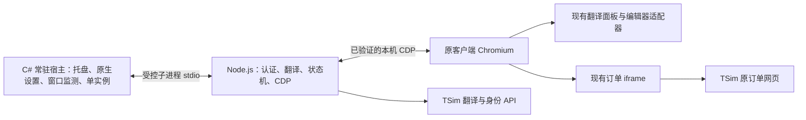

# 轻量常驻宿主改造计划

日期：2026-10-15。基线：当前工作区 package.json 0.3.2。状态：源码分析与方案计划，未实施替换、未操作客户端或发送消息。

## 1. 结论

可行。推荐先采用「独立 Node.js 业务进程 + 精简后的现有 C# 原生托盘宿主」，彻底移除运行包中的 Electron，继续复用现有 TypeScript 业务、安全状态机和客户端页面组件。完成可对比的性能原型后再决定是否进入全原生阶段。

这不是给 Electron 隐藏窗口或设置内存参数：常驻进程不再包含助手自己的 Chromium、GPU 和网络服务进程。原客户端中的翻译面板和订单 iframe 保持现有实现。Node.js 仍有 V8 开销，因此该路线是较低风险的第一阶段，不是内存最低的理论终点。

若第一阶段仍达不到资源预算，优先评估合并为单个 C# 宿主；只有确认必须追求更低常驻内存且愿意承担重写成本时，才选择 Rust/Win32。不要同时维护三套生产后台。

## 2. 当前事实与测量边界

上一轮现场采样的是正在运行的 0.3.1 包：助手进程树约 330 MB 工作集合计、188 MB 私有提交、5 秒平均整机 CPU 约 0.33%（20 逻辑处理器）。这不是当前 0.3.2 的正式基线，也不是注入前后差值。工作集含共享页；私有提交不等于实际驻留物理内存。

当前 0.3.2 必须保留：

- 原客服页面中的翻译预览、手动语言、自动跟随客户语言、暂停/恢复、复制和草稿替换。
- 原页面中的 TSim `/embed/operator` 订单 iframe、明确标识查询、关闭与会话切换清理。
- 翻译使用 Chrome/Edge 中的 TSim 会话；订单 iframe 使用原客户端自己的登录会话，两者保持独立。
- 原编辑器的 CAS 草稿一致性、IME、会话及账号代次验证；人工最终发送。
- 厂商指纹、PID/启动时间、调试端口所有者、唯一活动 target、租约和断连清理。
- 客户端未运行时仍有托盘、启动客户端、登录和设置入口。

订单 iframe 可能引入原客户端侧的渲染进程或内存增长，不能把这部分当成移除后台 Electron 就能节省的内存。现有文档 `docs/订单iframe验收-2026-10-15.md` 明确记录：真实商家客户端中的 iframe 登录及订单内容尚未完整验收。迁移必须补足，不能把隔离 Electron 的测试当成已通过的客户端基线。

## 3. 源码依赖审计

| 当前模块 | 观察 | 改造方式 |
| --- | --- | --- |
| `electron/main.ts` | app、Tray/Menu、BrowserWindow、screen、shell、clipboard、ipcMain；设置窗口按需创建 | 用原生托盘/设置、进程监督、显式动作协议替代 |
| `electron/preload.ts`、`security.ts`、`src/ui/*` | 本地 Electron 设置页面和 IPC 信任边界 | 退出生产依赖；将设置字段映射到原生窗口，保留旧入口供回退 |
| `electron/companion-service.ts` | 使用 Node crypto、业务类和计时器，不直接 import Electron | 抽到共享 core，原样保留竞态逻辑 |
| `browser-profile-session.ts`、`chromium-tsim-storage.ts` | Node 文件读取、fetch、LevelDB 解析 | 第一阶段保留，专门测缓冲区峰值 |
| `external-composer.ts`、`runtime/driver.ts`、`transport.ts` | Node 子进程、WebSocket、固定 CDP 策略 | 直接复用，注入脚本和 hash 独立于宿主构建 |
| `runtime/windows-platform.ts` | PowerShell 进程/端口探测；Electron 时用 original-fs；hash 当前一次读完整文件 | Node 下使用正常 fs；改流式 hash，逐步把探测移到原生端 |
| `runtime/page/*`、`runtime/native-composer.ts` | 在厂商 Chromium 中执行，订单 iframe 已属于生产入口 | 保留浏览器脚本，不迁入新宿主界面 |
| `native/windows/*` | 已有 .NET 10、WinForms/WPF、窗口事件、UIA及旧浏览器浮窗功能 | 新建精简目标，只编译当前需要的功能；复用有证据的窗口监测 |
| `scripts/build-electron.mjs`、electron-builder | 浏览器脚本内联到 Electron bundle；便携包带 Electron | 拆分 runtime/core/native 构建，改为版本化目录包，之后可选 SEA |

风险不只在外壳：当前附加后每 500ms 有观察/续租分支，认证后台默认 4 秒同步；LevelDB 读取单文件上限 64 MiB、累计预算 256 MiB，hash 使用完整 readFile。预算是防护上限，不代表真实占用；这些路径可能造成迁移后的峰值，必须测量。

## 4. 方案比较与成本

以下是熟悉当前代码的一名工程师的有效工作量估算，包含开发、回归、打包和真实客户端验证，不是已承诺的日历工期。账号/环境阻塞、证书采购及后端改造不包含在内。

| 方案 | 保留程度与成本 | 资源特点 | 建议 |
| --- | --- | --- | --- |
| A. 独立 Node.js + 精简 C# 宿主 | 约 7–12 人日；业务与浏览器代码大部分复用 | 移除助手 Chromium；保留 V8 与 CLR 两个运行时 | 首选，先用原型证明收益 |
| B. 单进程 C# 宿主 | 从当前基线约 14–24 人日；重写 TS 后台协议、认证解析和状态机 | 消除 Node；仍有 CLR，实际数值待测 | A 不达预算时再评估；A 后追加约 8–15 人日 |
| C. Rust/Win32 单进程 | 从当前基线约 22–35 人日；原生监测与业务都需迁移 | 有望得到更低基础开销；不保证整个客户端总内存 | 严格低内存目标才值得投入 |
| D. Tauri + Node sidecar | 约 9–16 人日；仍保留 TS 核心 | 保留 Node，设置若使用 WebView 还会产生 WebView 成本 | 本项目已有原页面 UI，收益不如 A 直接 |
| E. 把后台逻辑注入厂商主进程/修改安装包 | 无可接受成本估算 | 表面减少进程，却把权限、凭据和崩溃风险并入厂商进程 | 排除；保持运行时页面注入边界 |

Node 支持将 bundle 和资源打包为独立可执行程序，但 SEA 打包不等于消除 V8 内存。先锁定与现有 node24 构建目标兼容的 Node 24 LTS 补丁版，使用固定 node.exe + bundle 做可复现目录包；再按该版本文档评估 SEA，避免依赖新版本专属打包参数。[Node SEA 官方文档](https://nodejs.org/api/single-executable-applications.html)

Tauri 的 core 与 WebView 是不同进程；包体小不等于新增 WebView 没有内存成本。本项目不需要再增加一套常驻网页 UI。[Tauri 进程模型](https://tauri.app/concept/process-model/)

.NET Native AOT 有反射、动态加载和平台互操作限制。现有 WinForms/WPF/UIA 项目不能默认「加一个 AOT 开关就变轻」；AOT 仅作为拆出纯原生能力后的独立原型，不列为首版交付前提。[微软 Native AOT 文档](https://learn.microsoft.com/en-us/dotnet/core/deploying/native-aot/)

## 5. 推荐架构

C# 成为顶层 `WinExe`，持有单实例互斥体并启动隐藏 Node 子进程；当前 Node 启动 C# helper 的关系需要反转，不能互相循环拉起。

- C# 保留窗口发现/绑定/前后台事件，同时增加托盘与轻量原生设置。设置关闭即销毁，不创建 WebView。
- Node 复用现有核心和 CDP。`NativeAdapter` 改为可注入传输，接入既有父子进程 stdin/stdout，保留请求编号和事件语义。
- stdout 只用于协议；stderr 为限长、脱敏诊断。双向 JSON 消息必须有版本、大小限制、超时、固定动作与字段校验。
- 不新增本机 HTTP 服务。第二次启动通过仅当前用户可访问的命名管道通知主实例打开设置；管道不能接受任意 shell、脚本、URL 或文件路径。
- 打开登录、客户端启动和剪贴板使用固定原生动作；原生设置只显示必要状态，不接收 token、完整聊天记录或订单网页内容。
- 宿主监督 Node；异常退出先禁用操作，再有限次退避重启。父进程死亡时子进程退出；正常退出先 detach，再有界等待并清理自有子进程。不能结束厂商或用户浏览器进程。
- 单实例互斥与运行时租约必须覆盖旧、新宿主互斥。旧 Electron 无法参加新互斥协议时，检测并提示先退出旧版，不抢占已有 lease。

## 6. 分阶段实施及退出条件

| 阶段 | 工作与交付 | 估算 | 通过条件 |
| --- | --- | --- | --- |
| P0 基线 | 固定 0.3.2 源码/包 hash；收集场景性能、当前功能矩阵；补 iframe 基线 | 0.5–1 日 | 可重复测量，已知失败单列 |
| P1 可行性原型 | 新 Node 入口复用核心；C# 托盘壳和 stdio；不删除旧入口 | 1–2 日 | 无 Electron 进程仍能挂载、翻译和打开原订单 iframe；完成初步性能对照 |
| P2 正式替换 | 原生设置、单实例、启动/退出、父子监督、配置路径迁移、精简helper | 2–3 日 | 客户端未运行也可设置；退出/故障不留死连接；两种宿主不并行附加 |
| P3 资源优化 | 流式hash、认证解析内存分析、去除旧浮窗编译依赖、去重扫描与状态发布 | 1–2 日 | 达到资源预算且不放宽身份/草稿校验 |
| P4 发布验收 | 自动回归、独立对抗审查、真实客户端全链路、目录便携包与回退演练 | 2–4 日 | 功能和资源门禁都通过才替换默认包 |

P1 若内存下降不足 25%，暂停后续大范围迁移，先判断剩余开销属于 V8、CLR、缓存还是原客户端 iframe。不要为完成方案继续重写。若达到预算则交付 A，不自动追加 Rust 重写。

建议新增 `host-node/`、`native/resident/`、独立构建/打包/性能脚本；共享 core 的目录移动可最后做，避免把行为变更和大规模改名混在一起。保留旧 Electron 构建作为回退工具，但新发布包不得包含 Electron 或使用它处理设置。

## 7. 内存与性能验收预算

以下是候选工程目标，不是实测承诺。以 P0 同机、同版、同账号和相同页面场景的基线 B 为准；历史 188 MB 数值仅用于理解量级。

- A 目标：助手进程树静置 10 分钟后的私有提交 p95 ≤120 MiB，且相对 B 至少下降 35%；工作集合计只作辅助指标。
- 空闲 CPU：同机整机归一化 10 分钟平均 ≤0.3%，且不高于基线；不能用一条瞬时读数验收。
- 原客户端自身增量必须另测：不开订单、打开订单、关闭订单各自记录。新宿主不能把常驻负担转移到厂商进程后宣称节省。
- 连续 30 次翻译、20 次订单打开/关闭、20 次设置打开/关闭后，等待 5 分钟，助手私有提交较相应预热基线增长 ≤15 MiB且无持续上升趋势；8 小时稳定性报告单列。
- 同页挂载/恢复、输入到预览 p95 与基线比不劣化超过 10%；分离服务端网络耗时与本机排队耗时。
- 短期连接/hash/登录扫描峰值必须记录；稳态达标不能掩盖超过旧版的明显峰值。
- 不使用强制工作集裁剪、频繁GC或把进程挂起来美化数字。V8 heap 限额不覆盖 Buffer、原生内存、CLR 或 iframe，不能作为主要优化。

测量脚本每秒采样进程树（按PID和启动时间跟踪），记录私有提交、Private Working Set/工作集、CPU时间增量、句柄和进程数；纳入探测产生的临时 PowerShell进程。每场景至少3轮，预热后记录p50/p95/峰值，保留本机日志。至少覆盖未连接、前台空闲、最小化、连续输入翻译、订单iframe、设置、断连恢复、退出。

## 8. 不可牺牲的功能与安全验收

1. 原页面上完成预览、语言自动/手动、暂停/恢复、复制、草稿替换与撤销；真实中文 IME 组词期间禁止替换。验收草稿先备份、事后恢复，全程不发送客户消息。
2. 订单入口仍打开原 iframe，验证真实客户端内登录和结果；切换客户/隐藏/关闭后旧 frame 和消息失效。iframe 登录状态不能被错误当作翻译登录状态。
3. 翻译延迟回包、切会话、切账号、编辑器重建、客户端升级均拒绝旧结果替换。自动语言观察去重和语义保持 0.3.2。
4. 客户端退出、助手崩溃、Node崩溃、睡眠恢复、双启动均不会留下可写的过期桥或重复面板。
5. 只注入当前批准的页面脚本；不调用发送接口、不点击发送、不修改厂商文件，不扩大 iframe 或宿主动作权限。
6. 独立审查重点：stdio/命名管道来源验证、协议大小上限、进程归属、账号代次、清理/重启竞态、可执行文件替换风险、凭据日志泄漏。
7. 保留现有测试并新增传输/生命周期测试；Windows原生设置与真实客户端行为需实测，不能只用mock判通过。

## 9. 主要风险及回退

- 认证 LevelDB 解析是高风险模块：首版保留算法和测试。可优化分块读取/缓冲区生命周期，但必须保留删除记录、manifest变化、文件一致性与账号切换检查；不能缓存旧token来省资源。
- hash 改成流式读取时同时处理文件变化和读前读后身份校验。进程身份/端口归属仍在关键连接阶段验证，不以缓存替代必要校验。
- C#宿主裁剪要确认UIA/WPF真实依赖，不只删除项目引用。设置用原生控件，中文和DPI需真实检查。
- Node目录包、C#单文件或SEA都会有更新与版本锁定成本。首版选择可审计目录包，签名与单文件包装后置；固定绝对资源路径，不依赖 cwd 或 work/。
- 不改变业务配置语义。若移动用户数据目录，迁移前备份非敏感设置并记录版本；不复制浏览器凭据。
- 回退：优雅退出新宿主，确认面板/lease清理及子进程退出，再启动已保存的0.3.2包。新旧不能同时运行；不需要恢复厂商安装目录。

## 10. 本轮产出与后续决策

本轮仅产出此计划，未实施后台替换。建议下一次执行 P0–P1，拿到「无 Electron 原型 + 同场景资源对照」后按门槛继续 P2–P4。用户无需先选语言或打包技术；默认 Windows x64、保留全部0.3.2页面功能、用户级常驻、不安装系统服务、不新增常驻WebView。
